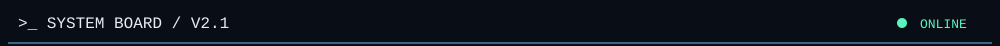

<picture><source media="(max-width: 600px)" srcset="./assets/system-header-mobile.svg"></picture>

<picture><source media="(max-width: 600px)" srcset="./assets/hero-mobile.svg"></picture>

<a href="https://github.com/Lmnhutw">GitHub</a> · <a href="mailto:lmnhut0211@gmail.com">Email</a> · <a href="https://www.linkedin.com/in/minhnhut0211/">LinkedIn</a> · <a href="https://animio.io.vn/">Animio</a>

<a href="https://github.com/Lmnhutw/visual-novel-gen"><picture><source media="(max-width: 600px)" srcset="./assets/current-quest-mobile.svg"></picture></a>

<picture><source media="(max-width: 600px)" srcset="./assets/quest-log-mobile.svg"></picture> <picture><source media="(max-width: 600px)" srcset="./assets/inventory-mobile.svg"></picture>

<a href="https://github.com/Lmnhutw/visual-novel-gen">Narrative Studio</a> · <a href="https://animio.io.vn/">Animio</a> · <a href="https://github.com/Lmnhutw/ChatApp_FE">ChatApp</a> · <a href="https://github.com/Lmnhutw/SkiiShop">SkiiShop</a> · <a href="https://github.com/Lmnhutw/YourSafe">YourSafe</a>

<a href="https://github.com/Lmnhutw?tab=repositories">View all repositories →</a>

<a href="https://github.com/Lmnhutw?tab=overview"><picture><source media="(max-width: 600px)" srcset="./assets/adventurer-log-mobile.svg"></picture></a>

<picture><source media="(max-width: 600px)" srcset="./assets/footer-mobile.svg"></picture>

<a href="https://github.com/Lmnhutw">GitHub</a> · <a href="mailto:lmnhut0211@gmail.com">Email</a> · <a href="https://www.linkedin.com/in/minhnhut0211/">LinkedIn</a> · <a href="https://animio.io.vn/">Animio</a>

V2.1.0 · BUILT WITH ♥ AND PIXELS

