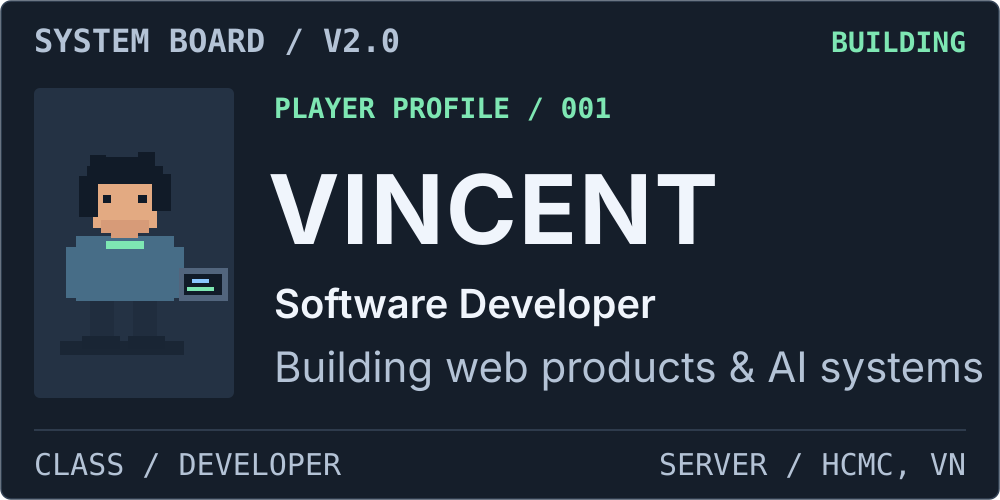
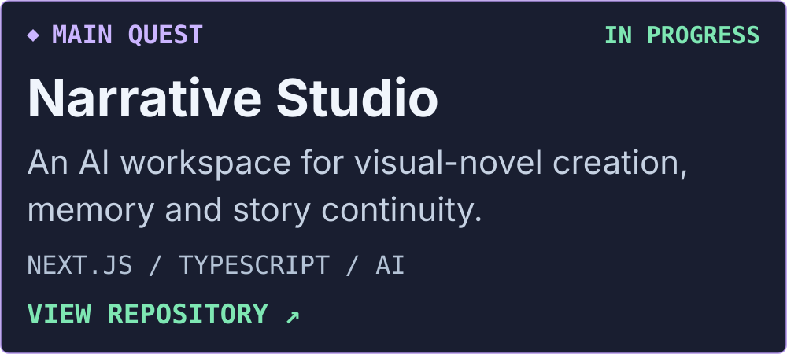
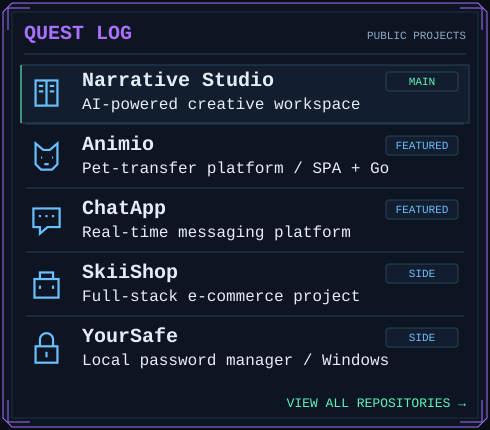
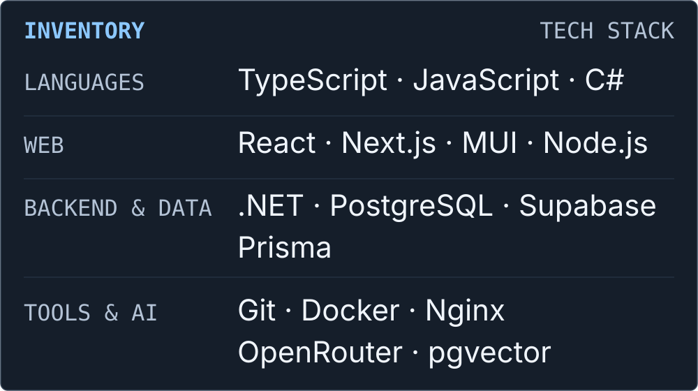
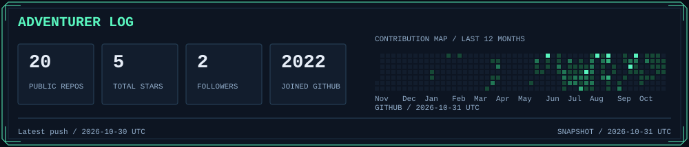

  

  

  <a href="https://github.com/Lmnhutw/visual-novel-gen"><b>Explore Narrative Studio →</b></a>

  

  <a href="https://github.com/Lmnhutw/OSAI"><b>OSAI</b></a>
  &nbsp;·&nbsp;
  <a href="https://github.com/Lmnhutw/ChatApp_FE"><b>ChatApp</b></a>
  &nbsp;·&nbsp;
  <a href="https://github.com/Lmnhutw/SkiiShop"><b>SkiiShop</b></a>

  

  

  <a href="https://github.com/Lmnhutw?tab=repositories">All repositories</a>
  &nbsp;·&nbsp;
  <a href="https://github.com/Lmnhutw?tab=overview">GitHub activity</a>

  

  <a href="https://github.com/Lmnhutw"><b>GitHub</b></a>
  &nbsp;·&nbsp;
  <a href="mailto:lmnhut0211@gmail.com"><b>Email</b></a>
  &nbsp;·&nbsp;
  <a href="https://www.linkedin.com/in/minhnhut0211/"><b>LinkedIn</b></a>
  &nbsp;·&nbsp;
  <a href="https://animio.io.vn/"><b>Animio</b></a>

